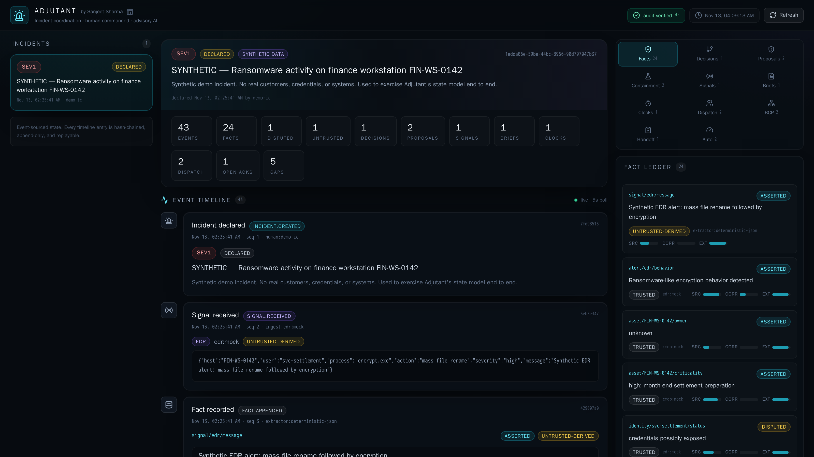
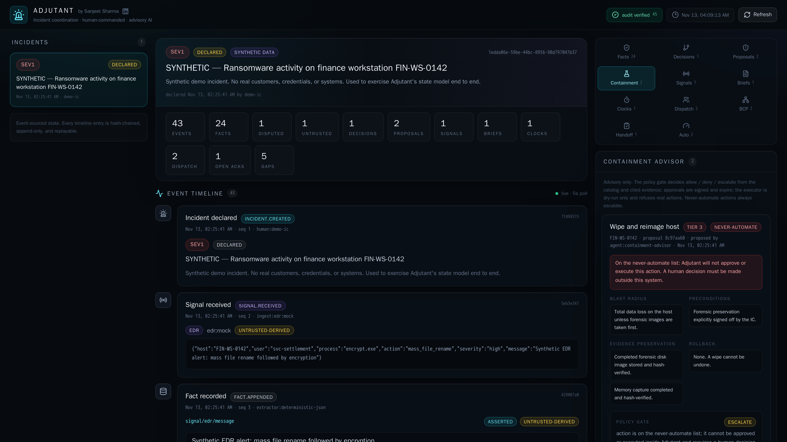
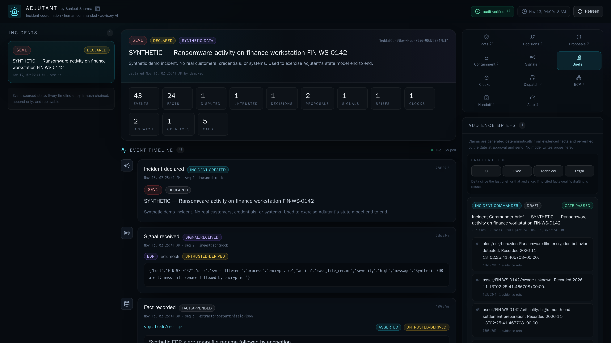
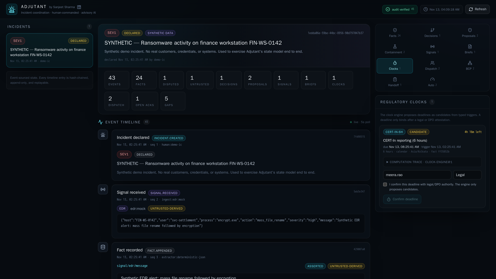
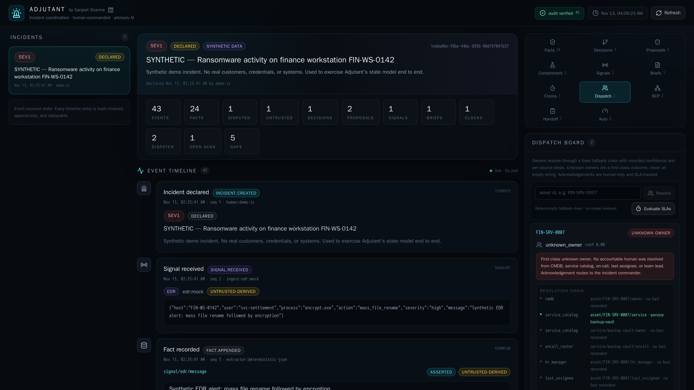
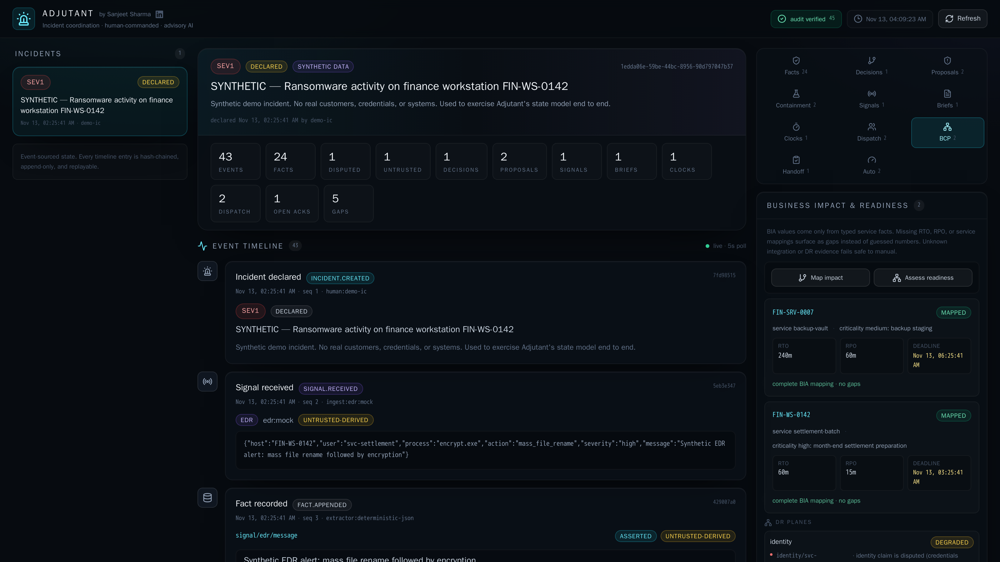
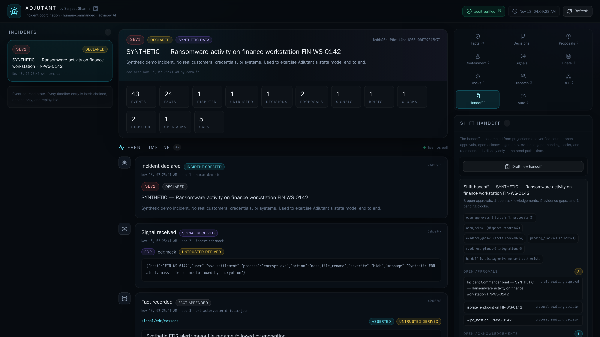
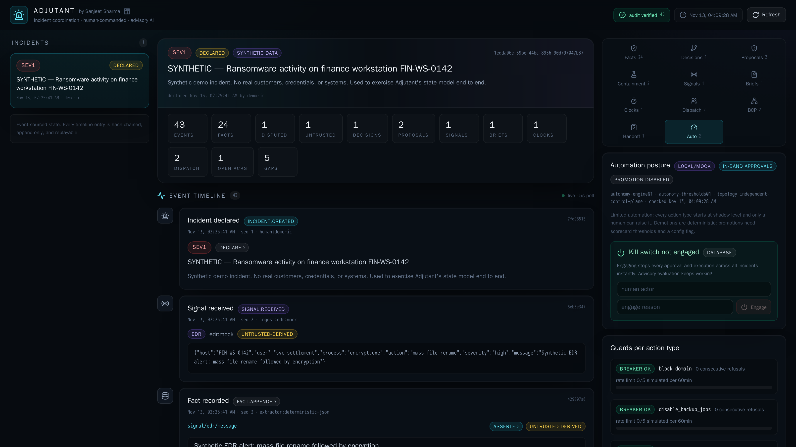

# Using the interface — walking the demo incident

This is the click-by-click tour. Start the stack, open the UI, and walk the
seeded synthetic ransomware incident (`FIN-WS-0142`) the way an incident
commander would — reading state first, then working every human gate.

```bash
docker compose up --build
```

Then open **http://localhost:8010/ui**. Nothing to configure: no logins, no
real data, no external calls. The UI is **display-and-gate** — you can read
everything, and the only actions available are the human ones.



## Orientation

- **Left rail** — the incident list. The seed ships one SEV1 incident; select
  it. Below it sits the event-sourced state note: every timeline entry is
  hash-chained, append-only, and replayable.
- **Center** — the incident header (severity, status, synthetic-data badge),
  the counters row (events, facts, disputed, untrusted, decisions,
  proposals, signals, briefs, clocks, dispatch, open acks, gaps), and the
  **event timeline** — the live hash-chained story of the incident, newest
  activity at the bottom.
- **Right rail** — the eleven tabs and the panels where work happens.
- **Header chips** — `audit verified` (the running audit-chain check), the
  incident clock, and Refresh. If the audit chip ever stops saying *verified*,
  stop and investigate.
- **Footer** — the honest-version banner: briefs are gate-checked, sends are
  human-approved, clocks are legal-confirmed, dispatch is human-acked,
  containment is dry-run only, and automation is guarded by an independent
  kill switch.

Walk the tabs top to bottom — that is the commander's natural flow.

## 1. Facts — read the state of the world

The fact ledger is the single source of truth. Each fact card shows the typed
attribute (`asset/FIN-WS-0142/criticality`), the value, status
(`asserted`/`disputed`), and the trust marker — `trusted` vs
`untrusted-derived`, with source (`edr:mock`, `cmdb:mock`,
`extractor:deterministic-json`) and provenance bars for source confidence,
corroboration, and extraction.

**What to notice:** the EDR message that started this incident entered as an
`untrusted-derived` fact. Untrusted facts are visible but never drive briefs,
clocks, or actions until a trusted source supersedes them.

## 2. Decisions — the human judgment log

Decisions are first-class facts (`decision/*` attributes) with the same
provenance as everything else. When you make calls later in this tour (a
containment approval, a clock confirmation), check back here — they land in
the ledger like any other fact.

## 3. Signals — the quarantine

Raw inbound content is stored exactly as received, marked untrusted. Only
allowlisted fields were converted into typed facts. The Signals tab is
display-only in this build — ingest new ones through the API:

```bash
curl -X POST http://localhost:8010/incidents/<incident_id>/signals \
  -H 'Content-Type: application/json' \
  -d '{"kind":"edr","source":"edr:mock","content":"{\"host\":\"FIN-WS-0142\",\"action\":\"file_encrypt\"}"}'
```

Watch the timeline: the signal is quarantined, the deterministic extractor
pulls typed fields, and anything it cannot vouch for stays untrusted.

## 4. Proposals — what the advisor recommends

The seeded containment proposals sit here — tiered actions (`T1` isolate
host, `T2` block domain, …) each with `justification_refs` pointing at the
facts that motivated them. These were drafted by
`agent:containment-advisor`. They are inert. The next tab is where they
either earn an approval or die at the gate.

## 5. Containment — the gate chain, live

This is the centerpiece tab.



For each proposal, walk the chain:

1. **Run policy gate** — the deterministic gate evaluates the proposal and
   answers `allow`, `deny`, or `escalate`, with reasons: tier rules, the
   never-automate list, missing citations, stale evidence, untrusted-data
   escalation, out-of-hours escalation. Try it on every seeded proposal —
   including the one that references the never-automate list, and watch it
   get refused an approval path entirely.
2. **Approve** — the gate re-runs at approval time on fresh facts. Approval
   is HMAC-signed, bound to the exact action hash, single-use, and expires.
   The card shows the nonce, key id, and signature.
3. **Dry-run execute** — the executor simulates the action, evidence
   preservation first, and consumes the approval. Try executing twice: the
   second attempt is refused — an approval can never be replayed. Real mode
   is refused unconditionally in this build.

**Expect to be blocked:** at the never-automate actions (no approval path
exists, in-band or out-of-band), at re-played approvals, and at any action
whose evidence went stale.

## 6. Briefs — draft, gate, approve, send



1. Pick an audience chip — **IC**, **Exec**, **Technical**, **Legal**. The
   scribe drafts one fully-cited claim per eligible fact from the audience's
   fact scope. No free-form prose exists anywhere in the draft.
2. The fact-checker runs automatically at draft: provenance, fact currency,
   trust, evidence, unsupported identifiers/dates/numbers, disputed-not-flagged.
   Verdicts: **PASS**, **NEEDS_REVIEW** (explicit human acknowledgment
   required), **FAILED** (unapprovable). Use **re-check** any time.
3. **Approve brief** — the gate re-runs against the ledger at approval. With
   a NEEDS_REVIEW verdict you must tick the review acknowledgment to proceed.
4. **Send mock** → click again to **Confirm send**. The two-click confirm is
   deliberate, and the transport is `mock://` — nothing leaves this
   environment.

**Expect to be blocked:** a FAILED gate cannot be overridden — approval
returns refused, no exceptions.

## 7. Clocks — deadlines that counsel owns



The seeded CERT-In candidate shows the full computation trace: trigger fact,
business-day math, holiday handling, and the resulting due timestamp. Every
candidate carries `requires_legal_confirmation` — until a human confirms it,
it drives nothing.

**Confirm deadline** requires a name and a legal attestation checkbox. That
attestation is the audit record: *a named human, in a named role, asserted
this deadline*. The advisor computes; counsel decides.

**Expect to be blocked:** confirming with no attestation; or confirming a
clock whose trigger fact has since been superseded — recompute is forced.

New candidates are proposed via the API (`POST /incidents/{id}/clocks` with a
trigger fact id).

## 8. Dispatch — owner resolution and the ack SLA



1. Enter the affected asset (`FIN-SRV-0007` is a good demo target) and hit
   **Resolve**. The resolution trace shows the deterministic fallback chain —
   CMDB owner → service catalog → on-call → HR manager → last assignee —
   every step marked used, rejected, or missing. Ties come back
   **ambiguous** with the owner withheld; an empty chain routes to the
   incident commander as `unknown_owner`.
2. The assignment gets an ack SLA scaled by severity. **Ack** is human-only —
   the SLA-met flag is computed from the record.
3. **Evaluate SLAs** re-checks pending acks and records breaches with
   escalation targets. Note what escalation is: a written recommendation in
   the event log. Nobody gets paged by software in this build.

## 9. BCP — impact and readiness, gaps included



**Map impact** produces the asset → service → business-impact mapping with
RTO/RPO from recorded facts. **Assess readiness** reads DR planes and
integration health from recorded checks only.

**What to notice:** missing data renders as an explicit gap and unverified
integrations read as **unknown** — never inferred, never assumed healthy.

## 10. Handoff — state, not narration



**Draft new handoff** assembles the end-of-shift brief from verified store
counts: open approvals, open acknowledgements, evidence gaps, pending clocks,
latest readiness, check results. The incoming commander gets numbers that
were queried, not written.

**Receive** is the receiving human's acknowledgment — the one gate on this
path. The handoff itself cannot send anything to anyone.

## 11. Auto — the automation controls



The posture pills at top say what mode you are in: `local/mock`,
`in-band approvals`, `promotion disabled`.

- **Kill switch** — enter an actor and a reason, hit **Engage**. Every
  approval and execution across all incidents stops instantly; advisory
  evaluation keeps working. Release needs a human and a reason too. Try it:
  engage the switch, then attempt a containment approval in the Containment
  tab — refused — then release.
- **Guards per action type** — circuit breakers (consecutive refusals trip
  them) and rate limits, with **Reset breaker** after review.
- **Autonomy levels** — `shadow → suggest → approve` per action type, with
  **Set level** and scorecards tracking refusals, denials, and outcomes.
  Promotion requires scorecard thresholds **and** a config flag
  (`AUTONOMY_PROMOTION_ENABLED`) that ships off. Demotion is deterministic
  and never gated.

**Expect to be blocked:** every consequential change here demands actor +
reason, and the kill switch wins over everything.

## Where to go next

- The **API walkthrough** in the [README](../README.md) does everything above
  over curl, including the automation drills.
- [agents.md](agents.md) — who produced each artifact you just walked past.
- [architecture.md](architecture.md) — the trust skeleton underneath: event
  store, facts, policy gate, approvals.
- [production-guide.md](production-guide.md) — what changes when this leaves
  the sandbox.
